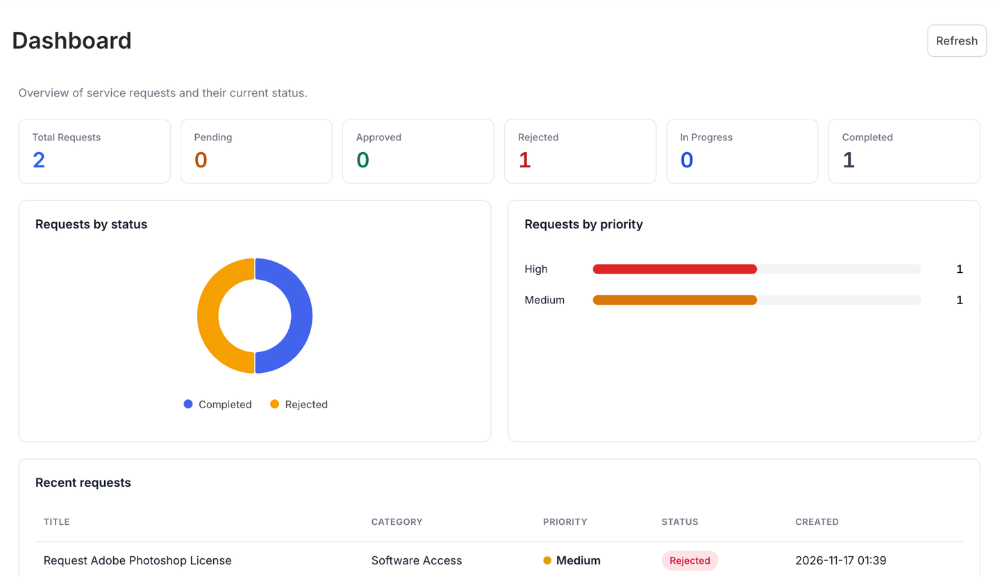
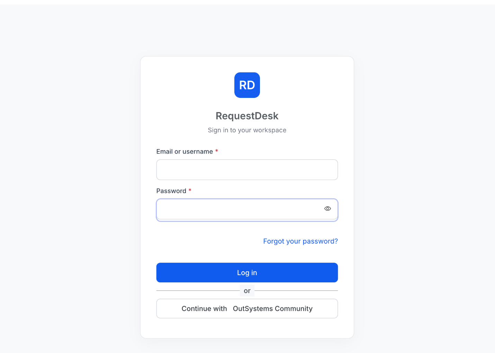
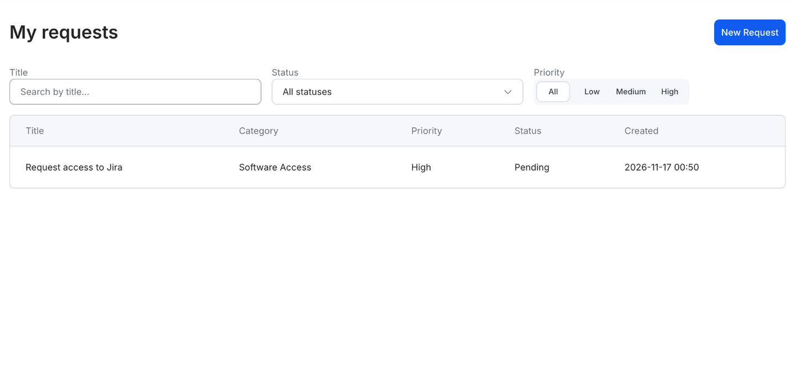
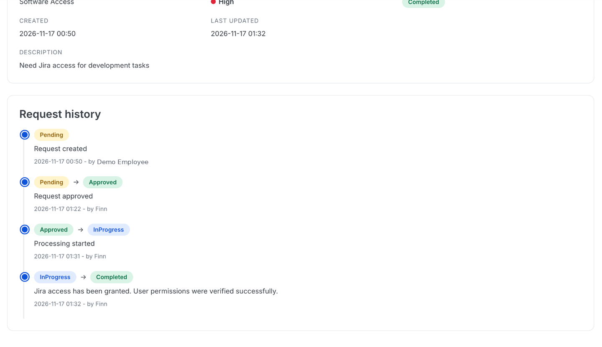
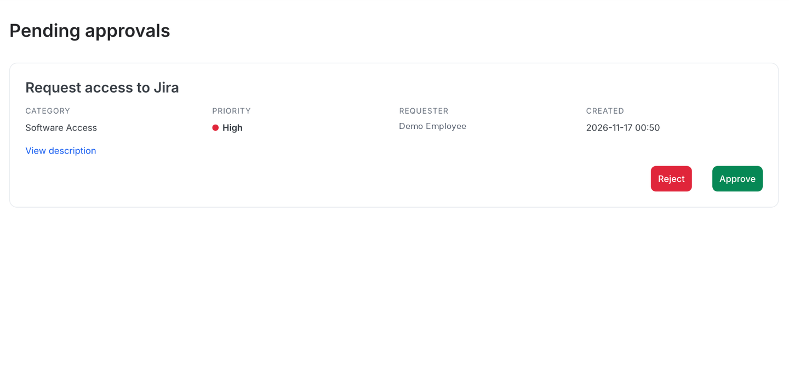
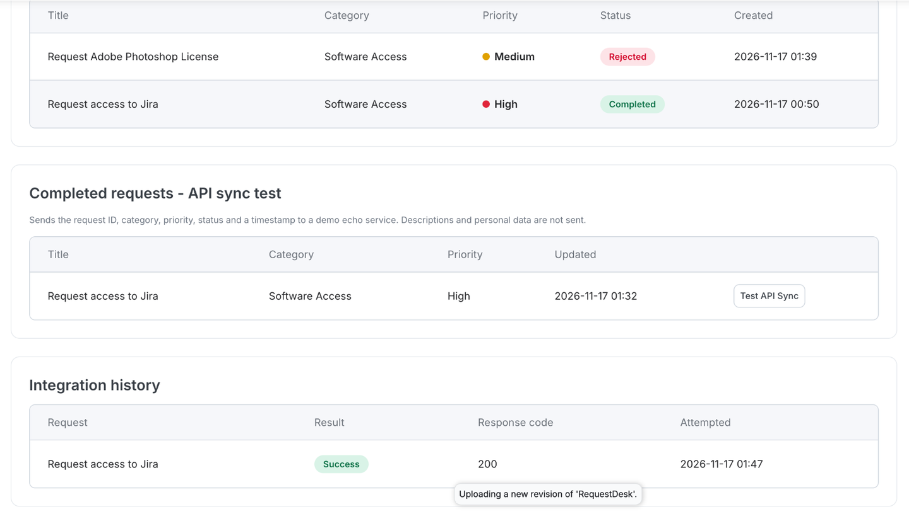

# RequestDesk

A small IT request management app I built while learning **OutSystems Developer Cloud (ODC)**.

I wanted to build something a little closer to a real internal tool than a basic CRUD app. In RequestDesk, employees submit requests, managers approve or reject them, and IT staff handle approved work. Each change is saved in a history timeline, so it's easy to see what happened to a request.

**[Open RequestDesk](https://personal-yaakoxkv-dev.outsystems.app/RequestDesk/)** · Sign-in required



## What you can do

- **Submit a request:** Choose a category and priority, then track its status from My Requests.
- **Approve or reject:** Managers review pending requests and provide a reason when rejecting one. They can't approve their own requests.
- **Process IT requests:** IT staff pick up approved requests and close them with a resolution note.
- **Follow the history:** Every status change is recorded with the previous and new status, who made the change, and when.
- **View the dashboard:** Managers can see request totals, a status breakdown, priority counts, and recent requests.
- **Test an API call:** A completed request can be sent to Postman Echo as JSON, with the result saved in an integration log.

## Request flow

```text
Pending ── Approve ──> Approved ──> InProgress ──> Completed
   │
   └────── Reject ──> Rejected
```

The approval and IT processing steps are handled by server actions. The requester, assignee, timestamps and status changes are set or checked on the server rather than taken from form inputs.

## Built with

**OutSystems ODC** · **ODC Studio** · Entities · Aggregates · Server Actions · Roles · REST API · CSS

The data model has four main entities: `Category`, `Request`, `RequestHistory`, and `IntegrationLog`. User references are used for the requester, assignee, and people who make changes.

A few things I paid particular attention to:

- Users can only open their own request details and history.
- Manager and IT staff actions check roles and valid status transitions on the server.
- Request updates and their history entries are handled together.
- Dashboard numbers come from database aggregates, not sample values.

## Screenshots

| | |
| --- | --- |
| **Login**  | **My requests**  |
| **Request history**  | **Manager approvals**  |
| **Dashboard**  | **API sync history**  |

## About the API demo

The sync feature sends basic request metadata (`RequestId`, category, priority, status and timestamp) to [Postman Echo](https://postman-echo.com/). The app checks the echoed JSON and records whether the test succeeded or failed.

It's a demo of consuming an external REST API, **not** a connection to a real ticketing system. The app currently doesn't capture the exact HTTP response code in its log.

## Project notes

This is a personal practice project, not a production helpdesk. I tested the main request, approval, processing, history, dashboard and API flows in the ODC development environment. Features such as email notifications, SLAs, reassignment and a real external ITSM integration are outside the current scope.

The app is built and hosted in OutSystems ODC, so **this repository contains the project overview and screenshots, not its source code**. Demo access requires an account with the appropriate role; I'm happy to walk through the app if needed.

*November 2026*
